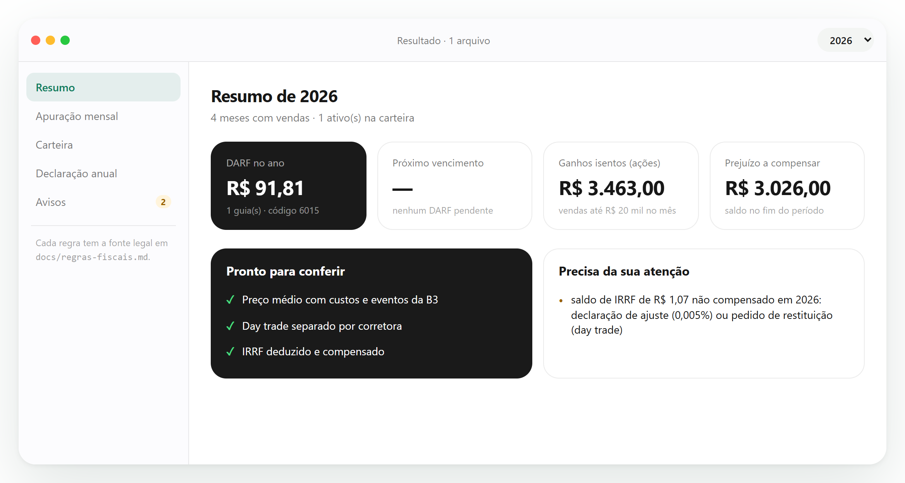
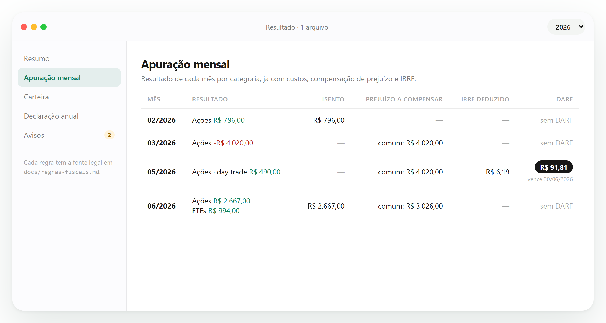

# b3-ir

[](https://github.com/StaffeToxic/b3-ir/actions/workflows/ci.yml)
[](https://github.com/StaffeToxic/b3-ir/releases/latest)
[](https://github.com/StaffeToxic/b3-ir/actions/workflows/codeql.yml)
[](https://scorecard.dev/viewer/?uri=github.com/StaffeToxic/b3-ir)
[](LICENSE)


**Calcule o Imposto de Renda de ações, FIIs e ETFs da B3 no seu computador**:
preço médio, apuração mensal, DARF, day trade, isenção de vendas de ações e os
dados da declaração anual (DIRPF). Interface no navegador, linha de comando e
biblioteca Python — com cada regra ligada ao texto da lei.


> 🇺🇸 **English summary below** — [jump to it](#english).

## Baixar

| Para | Como |
|---|---|
| **Windows, sem instalar nada** | Baixe o `b3-ir-windows-x64.exe` na [última versão](https://github.com/StaffeToxic/b3-ir/releases/latest) e dê dois cliques: o navegador abre com a interface. |
| **Quem tem Python 3.11+** | `pip install "b3-ir[pdf] @ https://github.com/StaffeToxic/b3-ir/releases/download/v0.1.1/b3_ir-0.1.1-py3-none-any.whl"` e depois `b3-ir web` |

O executável não é assinado digitalmente, então o Windows pode mostrar "O Windows
protegeu o computador": clique em **Mais informações → Executar assim mesmo**.
Para conferir que o arquivo saiu deste repositório, use o atestado de origem
(`gh attestation verify b3-ir-windows-x64.exe --repo StaffeToxic/b3-ir`) ou compare o
SHA-256 publicado na página da versão. Veja [SECURITY.md](SECURITY.md).

> [!WARNING]
> **Versão 0.1.** O b3-ir **não é consultoria tributária**. Você é o único responsável por
> conferir os valores e pela sua declaração. Leia o
> [Termo de Isenção de Responsabilidade](DISCLAIMER.md) antes de usar.

## O que ele faz

| Recurso | Status |
|---|---|
| Interface no navegador (`b3-ir web`), 100% local | ✅ pronto |
| Entrada manual em CSV | ✅ pronto |
| Preço médio com custos, desdobramento, grupamento e bonificação | ✅ pronto |
| Separação de day trade e operações comuns | ✅ pronto |
| Apuração mensal: ações, FIIs, ETFs, isenção, prejuízo, IRRF, DARF mínimo | ✅ pronto |
| Regras conferidas nos textos oficiais, versionados em [`legislacao/`](legislacao/) | ✅ 9 de 10 |
| Leitura de notas de corretagem em PDF (padrão SINACOR, via [correpy](https://github.com/thiagosalvatore/correpy)) | ✅ pronto (extra opcional) |
| Nome de pregão → ticker e classe (FII/ETF/ação) a partir do COTAHIST da B3 | ✅ pronto |
| Extratos da Área do Investidor da B3 (Negociação e Movimentação, XLSX) | ✅ pronto (formato a validar com export real) |
| Deduplicação entre notas e extrato | ✅ pronto |
| Relatório anual (DIRPF): bens e direitos, renda variável, isentos, JCP — texto, JSON e CSV | ✅ pronto |

**Fora do escopo do MVP:** opções, futuros, BDRs, renda fixa, criptoativos,
ativos no exterior, aluguel de ações e venda a descoberto. Esses itens são
**recusados explicitamente**, nunca calculados em silêncio.

## Princípios

- **Toda regra fiscal tem fonte legal citada** em [`docs/regras-fiscais.md`](docs/regras-fiscais.md),
  e o texto da lei está versionado em [`legislacao/`](legislacao/) (Planalto e Receita
  Federal, com SHA-256 da fonte). Um teste falha se uma lei citada não estiver lá.
  Regra não confirmada aparece como `UNVERIFIED` no relatório.
- **Valores exatos**: dinheiro em `Decimal`, nunca ponto flutuante.
- **Privacidade**: tudo roda localmente, sem acesso à internet e sem telemetria.

## Instalação para desenvolvimento

```bash
git clone https://github.com/StaffeToxic/b3-ir.git
cd b3-ir
python -m venv .venv
source .venv/bin/activate        # Windows: .venv\Scripts\activate
pip install -e ".[dev]"
pip install -e ".[pdf]"          # opcional: leitura de notas em PDF
```

> **Sobre o extra `pdf`:** a leitura de notas usa o correpy, que depende do
> PyMuPDF, licenciado como **AGPL-3.0**. Por isso ele é opcional: o b3-ir em si
> continua MIT, e só quem instala `b3-ir[pdf]` passa a usar código AGPL.

## Uso

### Interface no navegador

```bash
b3-ir web
```

Abre uma página no seu navegador. Marque o aceite do termo de isenção de
responsabilidade (pedido a cada uso), arraste as notas, os extratos ou uma pasta
inteira e veja a apuração mensal, a carteira e a declaração anual. Há um botão para
testar com dados de exemplo.

O servidor escuta só em `127.0.0.1`, exige um token (guardado na sua pasta de
configuração, para que uma aba aberta continue valendo depois de reiniciar), não
carrega nada da internet e apaga os arquivos ao fim de cada análise.






### Linha de comando

As entradas podem ser notas de corretagem em PDF (com o extra `pdf`), os extratos
da Área do Investidor da B3 em XLSX ou um CSV simples, todos juntos:

- **Negociação** (XLSX): operações, quando você não tem todas as notas. Não traz
  custos; se a nota da mesma operação existir, a nota prevalece.
- **Movimentação** (XLSX): desdobramentos, grupamentos, bonificações e proventos.

Para as notas, **use uma pasta por corretora**: o nome da pasta identifica a
corretora, e day trade só existe dentro da mesma corretora.

```text
notas/
├── xp/        nota-2026-03-02.pdf ...
└── clear/     nota-2026-03-05.pdf ...
```

O CSV manual está em [`examples/operacoes.csv`](examples/operacoes.csv):

```text
data;tipo;ticker;quantidade;preco;custos;irrf
2026-01-05;compra;ITSA4;1000;10,00;5,00;0
2026-02-10;venda;ITSA4;400;12,00;2,00;0,24
2026-04-01;bonificacao;ITSA4;60;5,00;;
```

```bash
b3-ir mensal examples/operacoes.csv
b3-ir posicoes examples/operacoes.csv --data 2026-04-30
b3-ir mensal examples/operacoes.csv --formato json
b3-ir anual examples/operacoes.csv --ano 2026
b3-ir anual examples/operacoes.csv --ano 2026 --formato csv --saida declaracao/
```

Saída (trecho):

```text
== 2026-05 ==
  Ações (day trade)           R$ 490,00
  Prejuízo a compensar: comum: R$ 4.020,00
  IRRF deduzido                 R$ 6,19
  DARF 6015: R$ 91,81 (período 2026-05, vence 30/06/2026)
  ! vencimento do DARF não considera feriados nacionais
```

Código de saída `3` indica resultado incompleto: arquivo não suportado ou regra
ainda `UNVERIFIED`. O contrato completo está em
[`specs/001-ir-mvp/contracts/cli.md`](specs/001-ir-mvp/contracts/cli.md).

## Arquitetura

```text
src/b3_ir/
├── domain/      núcleo puro, sem I/O: modelos, classificação, preço médio, apuração
├── parsers/     entradas: CSV manual, notas SINACOR (PDF), extratos da B3 (XLSX), deduplicação
├── data/        tabela de ativos gerada do COTAHIST da B3
├── catalog.py   nome de pregão → ticker → classe
├── report/      saídas em texto, JSON e CSV
├── inputs.py    leitura e unificação de todas as entradas (CLI e web)
├── web/         interface local: servidor só em 127.0.0.1 e página única
├── rules.py     registro único de regras fiscais com fonte legal
└── cli.py       comando b3-ir
```

Testes de arquitetura garantem que o domínio não faz I/O, não acessa a rede e não
usa `float`.

## Projetos parecidos

- [COIR](https://github.com/MarceloPCF/COIR): aplicativo para Windows, mais completo
  (opções, futuros, multa e juros do DARF). Licença AGPL-3.0.
- [correpy](https://github.com/thiagosalvatore/correpy): biblioteca Python que lê
  notas SINACOR, sem cálculo de imposto. Licença Apache-2.0.

O b3-ir é uma **biblioteca + CLI multiplataforma** com licença MIT, para quem quer
integrar o cálculo em scripts, planilhas ou outros sistemas, com cada regra
rastreável até o texto da lei.

## Desenvolvimento

O projeto segue *spec-driven development*: especificação, plano e tarefas ficam em
[`specs/`](specs/) e os princípios do projeto em
[`.specify/memory/constitution.md`](.specify/memory/constitution.md).

```bash
pytest
ruff check .
mypy
```

Veja [CONTRIBUTING.md](CONTRIBUTING.md). **Nunca anexe notas de corretagem ou
dados pessoais em issues.**

## English

**b3-ir computes Brazilian income tax on B3 stock, REIT (FII) and ETF trades, on
your own computer.** It reads SINACOR brokerage notes (PDF) and B3 investor-area
statements (XLSX), keeps the weighted average cost through splits and bonus
shares, pairs day trades per broker, and produces the monthly tax slips (DARF) and
the annual return (DIRPF) data.

What makes it different:

- **Every tax rule is traced to the law.** Rates, limits and deadlines live in one
  registry (`src/b3_ir/rules.py`), each with its legal citation and validity dates;
  the official texts are versioned as Markdown in [`legislacao/`](legislacao/), with
  the SHA-256 of the downloaded source. A test fails if a cited law is missing.
- **Exact money.** `Decimal` everywhere; architecture tests forbid `float`, I/O and
  network access in the domain core.
- **Refuses instead of guessing.** Unknown tickers, short sales and out-of-scope
  instruments are reported, never silently computed.
- **Local-first and private.** The optional web UI binds to `127.0.0.1` only, uses a
  per-user token, loads nothing from the internet and deletes uploads after each run.
- **Supply-chain hygiene.** CI on Linux, Windows and macOS (Python 3.11–3.13),
  CodeQL, OpenSSF Scorecard, Dependabot, SHA-pinned actions and build-provenance
  attestations for release binaries.
- **Spec-driven.** Specs, plans, contracts and research decisions are in
  [`specs/`](specs/).

Quick start: download `b3-ir-windows-x64.exe` from the
[latest release](https://github.com/StaffeToxic/b3-ir/releases/latest), or
`pip install` the wheel and run `b3-ir web`. The UI and docs are in Portuguese,
since the tax rules are Brazilian.

**Not tax advice** — see the [disclaimer](DISCLAIMER.md) (Portuguese).

## Licença

[MIT](LICENSE) © 2026 Anthony Oliveira. Uso sujeito ao
[Termo de Isenção de Responsabilidade](DISCLAIMER.md).
